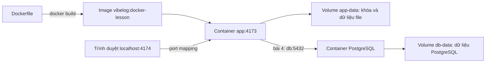

# Docker với VibeLog: bài 2–4

Tiếp nối [bài đầu tiên](lesson-2026-11-02-docker.md). Chạy các lệnh trong PowerShell tại `D:\LearnToVibe`. Đây là môi trường học local; Google OAuth chưa cấu hình, nhật ký chế độ thiết bị vẫn dùng được.

## Bản đồ các thành phần



## Bài 2 — Tạo image của chính VibeLog

Mở `Dockerfile` ở thư mục gốc và đọc theo thứ tự:

| Dòng lệnh | Vai trò |
| --- | --- |
| `FROM node:24-bookworm-slim` | Bắt đầu từ môi trường có Node.js 24 và Debian |
| `WORKDIR /app` | Các lệnh tiếp theo làm việc trong `/app` của image |
| `COPY package.json package-lock.json ./` | Đưa danh sách thư viện vào trước để tận dụng cache |
| `RUN npm ci --omit=dev` | Cài dependency theo lockfile, bỏ công cụ chỉ dùng khi phát triển/kiểm thử |
| Các dòng `COPY` tiếp theo | Đưa HTML, CSS, JavaScript và máy chủ vào image |
| `ENV ...` | Giá trị mặc định cho môi trường chạy local |
| `USER node` | Chạy ứng dụng bằng tài khoản không phải root |
| `EXPOSE 4173` | Ghi nhận cổng ứng dụng; chưa tự mở cổng ra máy |
| `HEALTHCHECK ...` | Kiểm tra định kỳ máy chủ có trả lời `/healthz` không |
| `CMD ...` | Lệnh chạy mặc định khi tạo container |

`.dockerignore` dùng danh sách cho phép để chỉ gửi file ứng dụng vào build context. Các file `.env`, dữ liệu phiên, cấu hình cloud và `node_modules` trên Windows không được chép vào image. Image tự cài dependency cho Linux.

Tự build lại để quan sát:

```powershell
docker build -t vibelog:docker-lesson .
docker image ls vibelog
```

`-t` đặt tên/tag cho image. Dấu `.` là thư mục build context. Những bước không thay đổi có thể hiện `CACHED`.

Muốn thử chạy bằng lệnh thuần, dùng cổng 4175 để không đụng stack Compose tại 4174:

```powershell
docker run -d --name vibelog-bai-2 --init -p 127.0.0.1:4175:4173 -e APP_URL=http://localhost:4175 vibelog:docker-lesson
docker logs --tail 20 vibelog-bai-2
docker exec vibelog-bai-2 node --version
```

Mở <http://localhost:4175>. `-e` đặt biến môi trường lúc chạy, ghi đè giá trị mặc định trong image. Trong container server phải nghe `0.0.0.0`; trình duyệt trên máy truy cập cổng đã ánh xạ.

Container thử này chưa gắn volume. Kết thúc bài bằng:

```powershell
docker stop vibelog-bai-2
docker rm vibelog-bai-2
```

`COPY` là chụp file vào lúc build. Khi sửa code trên máy, image/container hiện có chưa tự cập nhật. Với bài này, build rồi tạo lại container để nhận bản mới.

## Bài 3 — Compose và volume

Compose ghi các tùy chọn chạy vào YAML, giúp lặp lại môi trường bằng lệnh ngắn. `compose.yaml` định nghĩa một service `app`, cổng, biến môi trường và volume.

Nếu stack PostgreSQL của bài 4 đang chạy, dừng stack đó trước khi quay về bài 3:

```powershell
docker compose -f compose.yaml -f compose.postgres.yaml down
```

Khởi chạy chế độ file:

```powershell
docker compose up -d --build --wait
docker compose ps
docker compose logs --tail 20 app
```

Mở <http://localhost:4174>. Tên project `vibelog-docker-lab` giúp tìm nhóm này trong Docker Desktop. Volume `app-data` được gắn vào `/app/.vibelog-data`.

Phân biệt các nơi lưu:

| Nơi lưu | Điều gì xảy ra khi tạo lại container? |
| --- | --- |
| Lớp ghi của container | Không chuyển sang container mới |
| Named volume | Vẫn còn, được gắn lại nếu dùng cùng volume |
| `localStorage` trình duyệt | Nằm ở trình duyệt, tách theo origin; không do volume Docker lưu |

Vì chưa đăng nhập Google, nhật ký bạn nhập trên giao diện vẫn lưu trong `localStorage`. Cổng 4174 và 4173 là hai origin khác nhau nên có dữ liệu trình duyệt riêng. Việc nhật ký còn sau recreate tự nó chưa chứng minh volume hoạt động.

Để kiểm tra volume thật, script sau ghi bản ghi giả bằng kho phiên file của ứng dụng:

```powershell
docker compose exec -T app node docker/verify-lab.mjs seed
docker compose up -d --force-recreate --wait
docker compose exec -T app node docker/verify-lab.mjs check
```

Kết quả cần thấy: cả `seed` và `check` đều `PASS`. Container đã được tạo lại, nhưng file dữ liệu và khóa mã hóa trong volume vẫn còn.

`docker compose stop` dừng container; `start` chạy lại. `down` xóa container và network của project, giữ named volume. Không thêm `-v` nếu muốn giữ dữ liệu bài học: tùy chọn đó xóa cả named volume.

Bind mount khác volume: bind mount ánh xạ một file/thư mục cụ thể trên máy vào container; named volume do Docker quản lý. Bài 4 dùng bind mount chỉ đọc cho các file SQL khởi tạo và named volume cho dữ liệu database.

## Bài 4 — Chạy cùng PostgreSQL local

`compose.postgres.yaml` bổ sung `db` và đổi lệnh chạy của `app`. Compose gộp hai file cấu hình theo thứ tự:

```powershell
docker compose -f compose.yaml -f compose.postgres.yaml up -d --build --wait
docker compose -f compose.yaml -f compose.postgres.yaml ps
docker compose -f compose.yaml -f compose.postgres.yaml logs --tail 20 app db
```

Website vẫn tại <http://localhost:4174>. Lúc này:

- `app` tìm database qua tên service `db`, cổng nội bộ `5432`. `localhost` bên trong app là chính container app, không phải container database.
- `db` không công bố cổng ra máy; app truy cập qua network của Compose.
- `depends_on` cùng `service_healthy` chờ database sẵn sàng trước khi khởi động app.
- `app-data` giữ khóa mã hóa; `db-data` giữ database. Cần giữ cả hai để đọc lại các phiên mã hóa sau này.
- Image PostgreSQL chạy các file khởi tạo trong `/docker-entrypoint-initdb.d` khi volume database còn trống. Sửa SQL rồi restart không tự áp dụng lại cho volume đã có dữ liệu.

Ứng dụng hiện tại yêu cầu TLS khi dùng connector cloud. Bài local dùng entrypoint riêng `docker/serve-postgres.mjs`, kết nối cố định tới `db` với thông tin demo và không dùng TLS trong network bài học. App dùng tài khoản `vibelog_lab_app` không có quyền superuser/bypass RLS; tài khoản khởi tạo database là tài khoản riêng. Đây không phải cấu hình triển khai công khai. Google OAuth chưa được bật trong bài này.

Xem các bảng bằng công cụ `psql` ngay trong container database:

```powershell
docker compose -f compose.yaml -f compose.postgres.yaml exec db psql -U vibelog_lab -d vibelog_lab -c '\dt'
```

Ghi dữ liệu giả qua các lớp lưu trữ thật của ứng dụng, tạo lại cả hai container và đọc lại:

```powershell
docker compose -f compose.yaml -f compose.postgres.yaml exec -T app node docker/verify-lab.mjs seed
docker compose -f compose.yaml -f compose.postgres.yaml up -d --force-recreate --wait
docker compose -f compose.yaml -f compose.postgres.yaml exec -T app node docker/verify-lab.mjs check
```

Script kiểm tra HTTP, tài nguyên công khai, đường dẫn riêng bị chặn, các file riêng không nằm trong container, ghi/đọc phiên mã hóa và dữ liệu tài khoản giả. Nó cũng kiểm tra tài khoản database không phải superuser và hai ID giả đọc dữ liệu riêng. Bài này chưa kiểm chứng đăng nhập Google thật hay ghi Calendar.

Khi kết thúc, dừng cả stack và giữ volume:

```powershell
docker compose -f compose.yaml -f compose.postgres.yaml down
```

Không dùng `.env` cloud hiện tại cho bài này. Compose không khai báo `env_file` hoặc nội suy cấu hình cloud; image chạy Node trực tiếp và không tải `.env`.

## Câu hỏi để tự giải thích

1. `EXPOSE 4173` có làm trình duyệt truy cập được container không? Bước nào thực sự nối cổng?
2. Vì sao sửa JavaScript trên máy chưa làm website trong container đổi theo?
3. Vì sao app dùng `db:5432` thay cho `localhost:5432`?
4. Nếu xóa container nhưng giữ volume, những dữ liệu nào còn? `localStorage` nằm ở đâu?
5. `Dockerfile` và `compose.yaml` chịu trách nhiệm khác nhau thế nào?

## Kết thúc buổi học và mở lại lần sau

Để tự tắt mà giữ nguyên container và dữ liệu, chạy trong PowerShell:

```powershell
Set-Location D:\LearnToVibe
docker compose -f compose.yaml -f compose.postgres.yaml stop
docker stop docker-bai-1
docker ps
```

Lệnh đầu dừng app và database của bài học. Lệnh tiếp theo dừng website mẫu bài 1 (nếu bạn đã xóa nó thì có thể bỏ qua). `docker ps` chỉ hiện container đang chạy; nếu không còn container nào, chỉ thấy dòng tiêu đề. Nếu thấy container khác, đó không nhất thiết là container của bài học.

Sau đó chạy:

```powershell
docker desktop stop
```

Lệnh này dừng Docker Desktop. Cũng có thể bấm chuột phải biểu tượng cá voi Docker trong khay hệ thống Windows, gần đồng hồ (có thể nằm trong nút `^`), rồi chọn **Quit Docker Desktop**. Đóng cửa sổ bằng nút X có thể chỉ đóng giao diện.

Các lệnh `stop` trên giữ container, image và volume để học tiếp. Lần sau mở Docker Desktop, đợi Engine sẵn sàng rồi chạy:

```powershell
Set-Location D:\LearnToVibe
docker compose -f compose.yaml -f compose.postgres.yaml up -d --wait
```

Mở `http://localhost:4174`. Nếu muốn mở lại bài 1 thì dùng `docker start docker-bai-1`.

Muốn ôn chậm từ đầu trước khi thực hành tiếp, dùng [prompt dành cho ChatGPT](docker-review-prompt.md).

## Nguồn chính thức

- [Dockerfile reference](https://docs.docker.com/reference/dockerfile/)
- [Volumes](https://docs.docker.com/engine/storage/volumes/)
- [Compose và thứ tự khởi động](https://docs.docker.com/compose/how-tos/startup-order/)
- [PostgreSQL Official Image](https://hub.docker.com/_/postgres)
- [Dừng Docker Desktop](https://docs.docker.com/reference/cli/docker/desktop/stop/)
